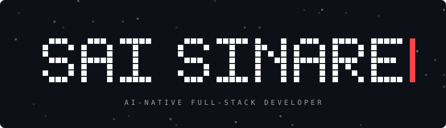

  

<h3 align="center">AI-native developer, currently exploring AI pipelines</h3>

  
  
  
  

---

### Tech

### Highlights

| | Project | Impact |
| --- | --- | --- |
| 🧾 | [**Recon AI**](https://github.com/Saisinare/recon-ai) | Bank-to-ledger reconciliation: code does the math, an LLM reads messy text, corrections become rules; **27/27 matched, 0 wrong** on the test set |
| 📚 | [**Synopsys VCS RAG**](https://github.com/Saisinare/Synopsys_VCS_RAG) | Fully offline assistant over Synopsys VCS docs: Llama 3.1 on Ollama, FAISS + TF-IDF hybrid retrieval; **85%+ retrieval accuracy** |
| ⚙️ | [**InsightX**](https://github.com/Saisinare/insightX-final) | Random Forest + Balanced Bagging classifiers detect **5 types of bearing failure** from motor vibration data ([HUST Bearing dataset](https://www.researchgate.net/publication/368829995_HUST_bearing_a_practical_dataset_for_ball_bearing_fault_diagnosis)), with a real-time React + Django dashboard |
| 📡 | [**Observer**](https://github.com/Saisinare/observer) | Metrics, logs and traces dashboard with a drop-in Express instrumentation module |

---

### Experience

| Role | What I did | Stack | When |
| --- | --- | --- | --- |
| **Software Developer Intern**, Ambugrid System ([certificate](https://drive.google.com/file/d/1cESAENJt_wL3MP9b8rlMz7Sx0Yz3GCwF/view?usp=sharing)) | Built the ParkVahan parking app (search and slot booking) and took it from first commit to a **live Google Play Store release in 2 months** | React Native · REST APIs | Jun 2026 – Nov 2026 |
| **Software Developer Intern**, Kadlag Investments ([certificate](https://drive.google.com/file/d/1q8Sl94TwMKDZTyOkN71vE1TyDe5ek_jW/view?usp=sharing)) | Built the back-office website and ERP used by **20 employees**, with a lead management dashboard and employee catalog; deployed on AWS | Node.js · Express · MongoDB · AWS | Jun 2025 – Sep 2025 |

### Open source

| Project | Contribution | Stars |
| --- | --- | --- |
| [**ONEARMY**](https://github.com/ONEARMY/community-platform/pull/5019) | Paginated admin Projects page with a server-side data service, plus unit and E2E tests | 1.4k+ |
| [**React95**](https://github.com/React95/React95/pull/600) | WAI-ARIA keyboard navigation for menus and submenus | 3.8k+ |
| [**ChunkHound**](https://github.com/chunkhound/chunkhound/pull/496) | Fixed similarity search ignoring path filters in the LanceDB backend of an AI code-search tool | 1.4k+ |

### Projects

#### Generative AI

| Project | What it is | Stack |
| --- | --- | --- |
| [**Recon AI**](https://github.com/Saisinare/recon-ai) | Bank-to-ledger reconciliation with a 5-layer pipeline (rules, LLM extraction, fuzzy match, split-payment solver, LLM judge) that learns rules from your approvals | Python · FastAPI · React · LLM (Groq / Gemini / Ollama) |
| [**Regression Manager Agent**](https://github.com/Saisinare/Regression-Manager-Agent-AI-Powered-VLSI-Regression-Test-Selection-System) | AI-powered VLSI regression test selection; cut simulation time from 10+ hours to 2–3 hours (~70%) | Python · LLM (Qwen3-8B) · Set-cover |
| [**Synopsys VCS RAG**](https://github.com/Saisinare/Synopsys_VCS_RAG) | Domain-adaptive RAG system for EDA tools such as Synopsys VCS | Python · RAG · LLM |
| [**promptfit**](https://github.com/Saisinare/promptfit) | Fits LLM prompts into a token budget: estimates tokens, ranks by relevance, compresses | Python · LLM · RAG |
| [**Slidesync.ai**](https://github.com/Saisinare/Slidesync.ai) | AI-powered slide generation | JavaScript |

#### Full-stack & mobile

| Project | What it is | Stack |
| --- | --- | --- |
| [**Cafe Management System**](https://github.com/Saisinare/cafe_app) | Ordering and billing app for cafes; cut order processing time by 30% | Flutter · Firebase · Razorpay |
| [**Rently**](https://github.com/Saisinare/Rently) | Cross-platform real estate app for renters and landlords | React Native · Expo · TypeScript |
| [**InsightX**](https://github.com/Saisinare/insightX-final) | Predictive maintenance: ML fault detection for induction motor bearings | React · Django · Scikit-learn |
| [**Alumni Connect**](https://github.com/Saisinare/Alumni_Connect) | Alumni data management and engagement platform (SIH 2025) | JavaScript |
| [**Expense Tracker**](https://github.com/Saisinare/Expense-Tracker) | Personal expense tracking app | TypeScript |
| [**Tracker**](https://github.com/Saisinare/Tracker) | Track and split group expenses | C++ |

#### Developer tools

| Project | What it is | Stack |
| --- | --- | --- |
| [**Observer**](https://github.com/Saisinare/observer) | Observability dashboard with drop-in Express instrumentation | Node · OpenTelemetry · Prometheus · Grafana · Jaeger · Loki · Docker |
| [**DustUI**](https://github.com/Saisinare/dustui) | Tree-shakeable React component library with Storybook docs | React · TypeScript · Rollup · Tailwind · Storybook |

#### Systems & trading

| Project | What it is | Stack |
| --- | --- | --- |
| [**mini-compiler**](https://github.com/Saisinare/mini-compiler) | Small compiler built from scratch | C++ |
| [**custom-assembler**](https://github.com/Saisinare/custom-assembler) | Custom assembler | C++ |
| [**kernel-profiler**](https://github.com/Saisinare/kernel-profiler) | Kernel profiling tool | C++ |
| [**Binance Trading Bot**](https://github.com/Saisinare/Binance-Trading-Bot) | Automated crypto trading bot | Python |

#### Problem solving

| Project | What it is | Stack |
| --- | --- | --- |
| [**DSA & CP**](https://github.com/Saisinare/DSA) | Data structures and competitive programming (300+ LeetCode) | C++ |

### Certifications & awards

| | Issued |
| --- | --- |
| [**Building with the Claude API**](https://academy.claude.com/verify/50f467081bcd7e046f814acd9521d393), Anthropic Academy | 2026 |
| [**IBM Full Stack Software Developer**](https://coursera.org/share/0d019c068eb8de280ae5a04c258db9a8), Coursera (15 courses, listed below) | 2026 |
| [**Node.js Development**](https://drive.google.com/file/d/1zKdE4OHgzIxX8o3Qafm6iEDTjOfEVyuz/view?usp=sharing), Udemy | 2023 |
| 🥉 **Second Runner-up**, Impetus Hackathon | 2025 |
| 🥈 [**Second Place**](https://drive.google.com/file/d/1zKt84Ag07JZ7QB1M1SwTRaiX4J7y8dZp/view?usp=sharing), I2I Competition | 2023 |

#### IBM Full Stack Software Developer courses

| Course | Issued | Credential |
| --- | --- | --- |
| Introduction to Software Engineering | Mar 27, 2026 | [Verify](https://coursera.org/verify/XGCFNT5BF7EY) |
| Introduction to Cloud Computing | Mar 27, 2026 | [Verify](https://coursera.org/verify/408C0FU8R82O) |
| Python for Data Science, AI & Development | Mar 27, 2026 | [Verify](https://coursera.org/verify/NF7KYKTL368K) |
| Introduction to HTML, CSS, & JavaScript | Mar 28, 2026 | [Verify](https://coursera.org/verify/PTSHH8L0741Z) |
| Getting Started with Git and GitHub | Mar 28, 2026 | [Verify](https://coursera.org/verify/XWFPXGSKXMNV) |
| Developing Front-End Apps with React | Mar 28, 2026 | [Verify](https://coursera.org/verify/1BE6S1ARA8W5) |
| Developing Back-End Apps with Node.js and Express | Mar 28, 2026 | [Verify](https://coursera.org/verify/3ZFH48RVWG76) |
| Developing AI Applications with Python and Flask | Mar 28, 2026 | [Verify](https://coursera.org/verify/U5NR2YO6VU2D) |
| Django Application Development with SQL and Databases | Mar 28, 2026 | [Verify](https://coursera.org/verify/13PVLZMQWVCB) |
| Introduction to Containers w/ Docker, Kubernetes & OpenShift | Mar 28, 2026 | [Verify](https://coursera.org/verify/OTAWK3RK8OYO) |
| Application Development using Microservices and Serverless | Mar 28, 2026 | [Verify](https://coursera.org/verify/4K9CCKQJ3SGW) |
| Full Stack Application Development Capstone Project | Mar 28, 2026 | [Verify](https://coursera.org/verify/CS7DJ16R6VQZ) |
| Software Developer Career Guide and Interview Preparation | Mar 28, 2026 | [Verify](https://coursera.org/verify/JJRCNRF0EXWT) |
| Generative AI: Elevate your Software Development Career | Mar 28, 2026 | [Verify](https://coursera.org/verify/CBRW5TLAT722) |
| Full Stack Software Developer Assessment | Mar 29, 2026 | [Verify](https://coursera.org/verify/VM69YHSCKLD9) |

### Get in touch

Open to SDE internship opportunities. The fastest way to reach me:

---

Thanks for stopping by.

