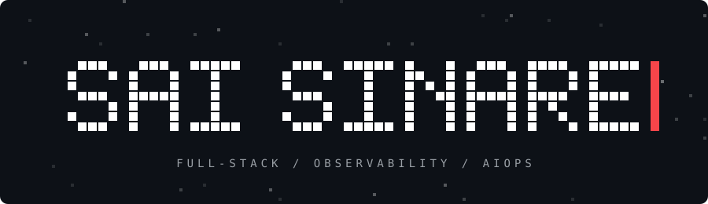
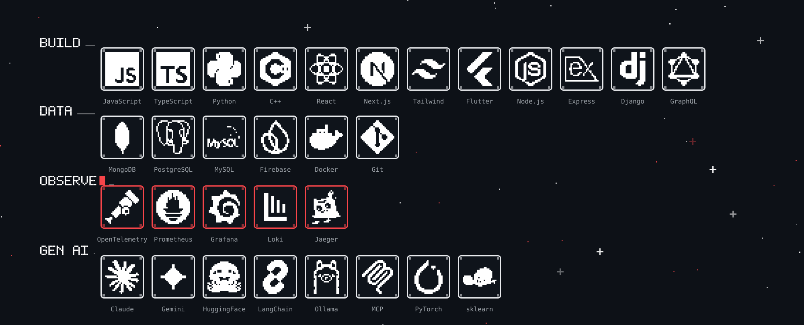

  

---

### Tech

### Projects

| Project | What it is | Stack |
| --- | --- | --- |
| [**API Observability Platform**](https://github.com/saisinare) | Distributed tracing, metrics and centralized logging with a drop-in Express instrumentation module | Node · OpenTelemetry · Prometheus · Grafana · Jaeger · Loki · Docker |
| [**DustUI**](https://github.com/saisinare) | Tree-shakeable React component library with Storybook docs | React · TypeScript · Rollup · Tailwind · Storybook |
| [**Insight X**](https://github.com/saisinare) | Predictive maintenance: ML fault detection for induction motor bearings | React · Django · Scikit-learn |
| [**Cafe Management System**](https://github.com/saisinare) | Ordering and billing app; cut order processing time by 30% | Flutter · Firebase · Razorpay |

### Certifications

IBM Full Stack Software Developer (Coursera) · Node.js Development (Udemy)

---

Open to SDE internship opportunities. Feel free to reach out.

